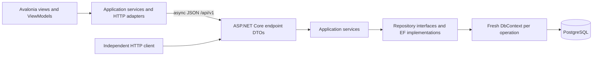

# Lab 5 baseline and architecture

## Baseline record

| Field | Record |
| --- | --- |
| Authentic Lab 4 submission | `f4fd4e2de5783aab4e22e05211785e590ad549fa` — `Complete Lab Activity 4 (#3)` on this repository's master history. This is the submitted snapshot identified during Lab 4 completion, not a tag retroactively placed on newer work. |
| Baseline capability/limitations | Fourteen implemented use cases, Avalonia application services, PostgreSQL EF migration, serializable checkout/return, histories/search and Lab 4 documentation. Desktop instantiated persistence directly; no HTTP API existed. Original history is available. |
| Lab 5 continuation | API base `5d324da`, full contract `8d3ef88`, desktop HTTP integration `355d59e`, Jd's initial acceptance evidence `a071d8e`, followed by acceptance completion and submission documentation. |
| Final revision | The commit targeted by `lab5-submitted` is the completed revision. Resolve its full immutable SHA with `git rev-parse lab5-submitted^{commit}`; inspect with `git show --no-patch lab5-submitted`. The tag is created on the completed integrated revision after the final documentation commit. |
| Migrations | Existing `20261118125230_InitialPostgreSql` and model snapshot preserved. Lab 5 adds a transport boundary without a schema change; no new migration is needed. Existing keys, foreign keys, normalized uniqueness, active-equipment unique index and date/status checks remain. |
| Reproduction | [README](../README.md), [controlled reset/tools](../scripts/lab5/README.md), [consolidated results](lab5-test-results.md), [traceability](lab5-traceability.md). |

The [Lab 4 suite](lab4-use-case-suite.md) continues to define the same fourteen
actor goals. Lab 5 introduces API integration, not UC-10/11 or the other cases
listed as deferred in the historical Lab 4 catalog. No replacement set of
fourteen use-case tables is invented. BR-01–19 remain applicable.

## Boundary before and after

Before: `App.axaml.cs` registered EF/PostgreSQL repositories in the desktop.
Now: desktop registers HttpClient and HTTP repository adapters. The API is the
only production host that instantiates persistence. The API does not launch or
reference Avalonia and can be used with PowerShell while the desktop is closed.

The desktop keeps domain/application types for presentation and early feedback;
server-side services independently validate the request. Client validation never
authorizes a database change. `ApiModels` maps published camel-case fields into
domain snapshots; `Borrowing.FromSnapshot` preserves identity/history without
changing current item availability. Transport failure has no HTTP status, unlike
a received API JSON error.

## DI and context lifetime

[API Program](../src/EquipmentBorrowing.Api/Program.cs) registers a
`DbContextFactory`, stateless services/repositories and `PostgresOperations`.
Singleton repositories hold the factory wrapper, **not** a DbContext. Each read
or write creates/disposes its own context. This avoids a shared change tracker
across HTTP requests. Read queries use `AsNoTracking` and include related records.

[Desktop composition](../src/EquipmentBorrowing.Desktop/App.axaml.cs) uses one
HttpClient with a 15-second timeout and repository adapters, disposed with its
service provider at exit. ViewModels load asynchronously; loading/error state
and explicit Refresh/retry remain available. The
[desktop project](../src/EquipmentBorrowing.Desktop/EquipmentBorrowing.Desktop.csproj)
references Application, not Infrastructure, EF Core or Npgsql. Application
references Domain. No database connection string is required by the desktop.

## Transactions and failures

[PostgresOperations.WriteAsync](../src/EquipmentBorrowing.Infrastructure/Persistence/PostgresOperations.cs)
creates a serializable transaction. Checkout reads the current student, eligibility,
equipment availability, existing active loans and active count inside that
transaction before staging changes. Single checkout and batch share this path.
SaveChanges and Commit encompass both borrowing rows and availability updates.
The database's filtered unique active-item index prevents a second active holder;
serialization/uniqueness conflicts return 409. There is no blind mutation retry.

Known pre-commit failures roll back. If commit acknowledgement is uncertain,
`committing` classification yields `outcome_unknown` rather than claiming failure
means no write. [ApiTransport](../src/EquipmentBorrowing.Desktop/Api/ApiTransport.cs)
reports the unknown outcome and prevents further mutation until a successful
fresh read; staff then inspect the relevant history before deciding to retry.
The UI's internal readback does not automatically repeat the write.

Endpoint validation maps malformed input to 400, absence to 404, business conflict
to 409 and server/storage failure to safe 500. Exception details remain in local
server diagnostics. [ApiErrors](../src/EquipmentBorrowing.Api/ApiErrors.cs) publishes
only safe code/message objects. A stopped API is shown as a connection failure;
a received 500 displays the API's safe message.

## Evidence and limits

T01–T06 exercise all 16 operations independently; T02–T05 include fresh DB reads
and restarts. T05's disposable trigger proves rollback after an initial insert.
T07 includes actual UI interaction, external update/refresh, API responses and
database readback. T08 includes real API outage and invalid-database HTTP 500,
recovery and a deterministic simulation of the unknown-outcome client gate.
A physically lost real commit acknowledgement was not manufactured.

The checked-in OpenAPI 3.0.3 file is served at `/openapi/v1.json` and copied into
build/publish output. DTOs and schema changes must be reviewed together; the
acceptance runner checks actual response shapes against that file.
